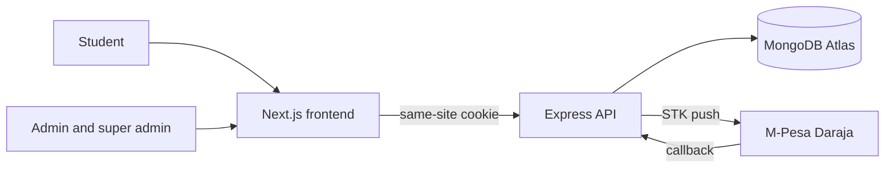

# CampusStay

[](https://github.com/YOUR_ORG/campusstay/actions/workflows/ci.yml)
[](LICENSE)

CampusStay is a hostel booking and management system for a university. Students search for a room, reserve it, and pay the booking fee with M-Pesa. Hostel admins approve bookings and keep the room list current. A super admin also manages staff accounts. Reports cover bookings, payments, and occupancy.


Replace `YOUR_ORG` in the CI badge after the team creates the GitHub repository.

## Features

- Student registration, login, logout, and a password-reset route ready for implementation
- Separate access for students, admins, and the super admin
- Room search by hostel, room type, price, and availability, with pagination
- A database rule that blocks two active bookings for the same room
- Planned M-Pesa STK push, payment records, and confirmation
- Admin management of users, rooms, and bookings
- Filterable reports that include the date, organization name, and logo
- An audit log of important actions

## Tech stack

| Area       | Choice                                                               |
| ---------- | -------------------------------------------------------------------- |
| Frontend   | Next.js (App Router), TypeScript, Tailwind CSS, Zod, React Hook Form |
| Backend    | Node.js, Express, TypeScript, MongoDB Atlas, Mongoose                |
| Auth       | bcrypt password hashes, JWT in an httpOnly cookie                    |
| Validation | Zod on every request body, query, and route param                    |
| Tests      | Vitest, Supertest, and an in-memory MongoDB server                   |
| Tooling    | npm workspaces, ESLint, Prettier, Husky, lint-staged, GitHub Actions |

## Architecture



The browser talks to the Next.js app. Next.js proxies `/api` to the Express API, so the session cookie stays on the website. Express is the only component that talks to MongoDB and M-Pesa. See [docs/02-ARCHITECTURE.md](docs/02-ARCHITECTURE.md).

## Repository structure

```text
campusstay/
  frontend/          Next.js app
  backend/           Express API, models, and seed script
  docs/              Requirements, design, API, tests, and the project plan
  .github/           CI workflow, issue templates, pull request template, CODEOWNERS
  package.json       npm workspaces and root scripts
```

## Prerequisites

- Node.js 22 or newer
- npm 10 or newer
- A MongoDB Atlas cluster, or another MongoDB server, for running the API

Tests do not need Atlas. They start an in-memory MongoDB server.

## Quick start

From the repository root:

```bash
npm install
```

Create local environment files and set the real database string in `backend/.env`:

```bash
# macOS and Linux
cp backend/.env.example backend/.env
cp frontend/.env.example frontend/.env

# Windows PowerShell
Copy-Item backend/.env.example backend/.env
Copy-Item frontend/.env.example frontend/.env
```

Keep `JWT_SECRET` identical in both files. Leave `NEXT_PUBLIC_API_URL` empty so the browser uses the Next.js proxy.

```bash
npm run seed
npm run dev
```

- Website: http://localhost:3000
- API health check: http://localhost:4000/api/v1/health

`npm run dev` starts both apps. Stop it with Ctrl+C.

## Scripts

| Script              | What it does                                  |
| ------------------- | --------------------------------------------- |
| `npm run dev`       | Starts the API and the website together       |
| `npm run build`     | Compiles both packages                        |
| `npm run lint`      | Runs ESLint in both packages                  |
| `npm run format`    | Formats the repo with Prettier                |
| `npm run test`      | Runs backend and frontend tests               |
| `npm run typecheck` | Runs the TypeScript compiler in both packages |
| `npm run seed`      | Loads idempotent demo data                    |

## Seeded demo accounts

Run `npm run seed` before using these. Passwords are for local demos. Do not reuse them in production.

| Role        | Email                         | Password        |
| ----------- | ----------------------------- | --------------- |
| super_admin | peter.kamau@campusstay.test   | SuperAdmin#2026 |
| admin       | grace.mwangi@campusstay.test  | Admin#2026      |
| student     | amina.wanjiku@campusstay.test | Student#2026    |
| student     | brian.otieno@campusstay.test  | Student#2026    |

The seed also creates Kilimo Hostels and Lakeside Hall, with ten rooms between them. Prices are Kenyan shillings per month.

## API overview

All routes live under `/api/v1`. Successful responses use `{ "success": true, "data": {} }`. Failures use `{ "success": false, "error": { "message": "", "details": {} } }`.

Working routes:

| Method | Path             | Who                                                                                         |
| ------ | ---------------- | ------------------------------------------------------------------------------------------- |
| GET    | `/health`        | Public                                                                                      |
| POST   | `/auth/register` | Public, creates a student                                                                   |
| POST   | `/auth/login`    | Public                                                                                      |
| POST   | `/auth/logout`   | Public, clears the cookie                                                                   |
| GET    | `/auth/me`       | Signed-in user                                                                              |
| GET    | `/rooms`         | Public. Filters: `hostel`, `roomType`, `minPrice`, `maxPrice`, `available`, `page`, `limit` |

Every other route is registered, validated, and protected with the correct role, and returns `501` until the owning member implements it. The full table is in [docs/04-API-SPECIFICATION.md](docs/04-API-SPECIFICATION.md).

## Team

| Member | Role                                 | Owns                                            |
| ------ | ------------------------------------ | ----------------------------------------------- |
| 1      | Project manager and business analyst | `docs/`, requirements, user manual              |
| 2      | Database designer                    | `backend/src/models`, `backend/scripts/seed.ts` |
| 3      | Front-end developer                  | `frontend/`                                     |
| 4      | Back-end developer                   | API routes, services, M-Pesa, and security      |
| 5      | QA and documentation                 | Tests, the test plan, audit review, and reports |

Details and the folder map are in [docs/TEAM-AREAS.md](docs/TEAM-AREAS.md).

## Documentation

| Document                                                     | Contents                                          |
| ------------------------------------------------------------ | ------------------------------------------------- |
| [docs/01-SRS.md](docs/01-SRS.md)                             | Software requirements                             |
| [docs/02-ARCHITECTURE.md](docs/02-ARCHITECTURE.md)           | Context, flows, and technology choices            |
| [docs/03-DATABASE-DESIGN.md](docs/03-DATABASE-DESIGN.md)     | Collections, indexes, and the double-booking rule |
| [docs/04-API-SPECIFICATION.md](docs/04-API-SPECIFICATION.md) | Endpoint contract                                 |
| [docs/05-TEST-PLAN.md](docs/05-TEST-PLAN.md)                 | Test scope and acceptance criteria                |
| [docs/06-SECURITY.md](docs/06-SECURITY.md)                   | Threats and the controls in this repo             |
| [docs/07-DEPLOYMENT.md](docs/07-DEPLOYMENT.md)               | Atlas, hosting, and the release checklist         |
| [docs/08-USER-MANUAL.md](docs/08-USER-MANUAL.md)             | Student and admin manual outline                  |
| [docs/09-PROJECT-PLAN.md](docs/09-PROJECT-PLAN.md)           | Milestones, tasks, and risks                      |
| [docs/10-CODING-STANDARDS.md](docs/10-CODING-STANDARDS.md)   | Names, errors, commits, and reviews               |

## License

CampusStay is released under the [MIT License](LICENSE).
