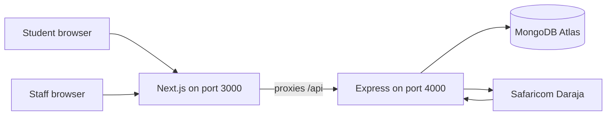
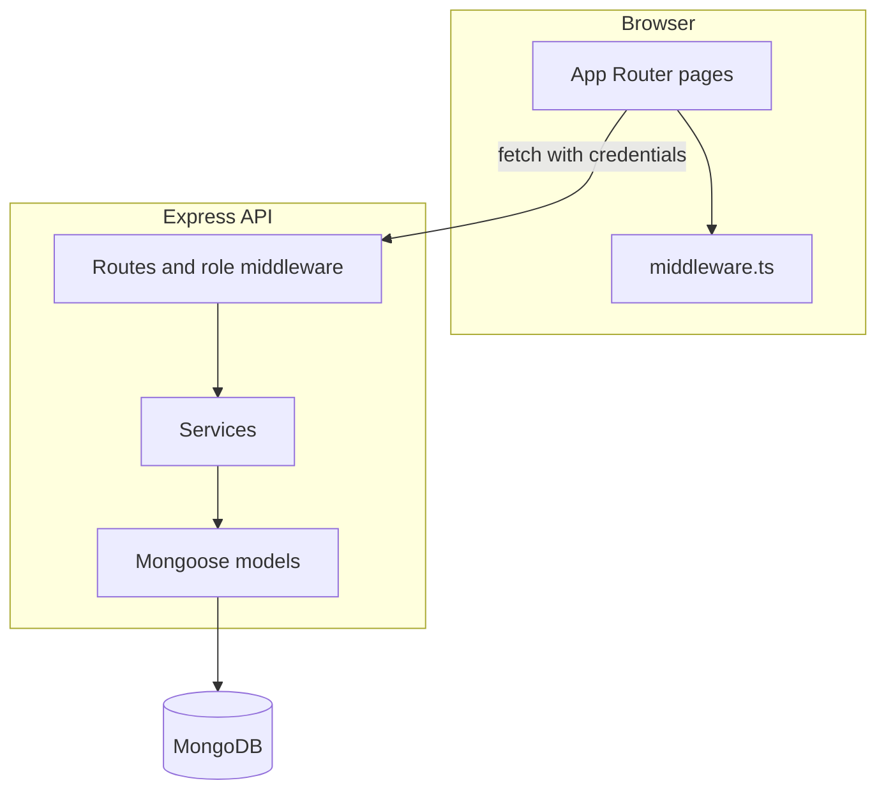
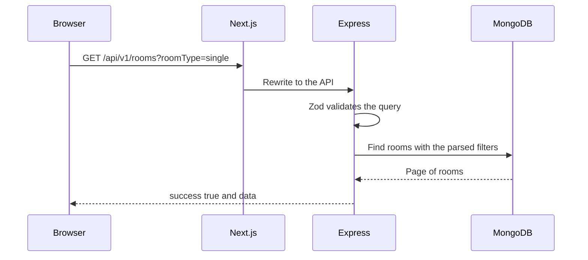
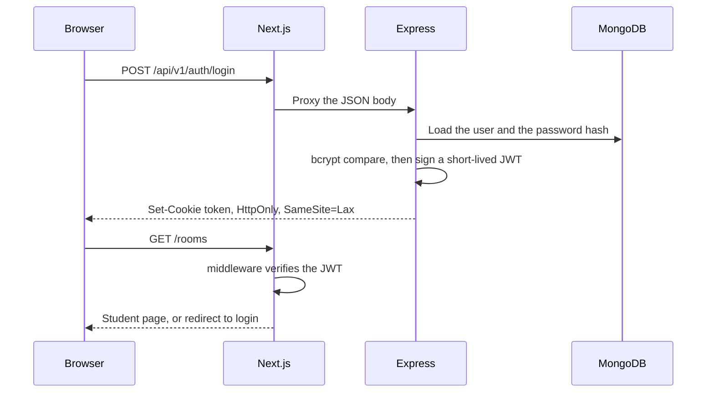
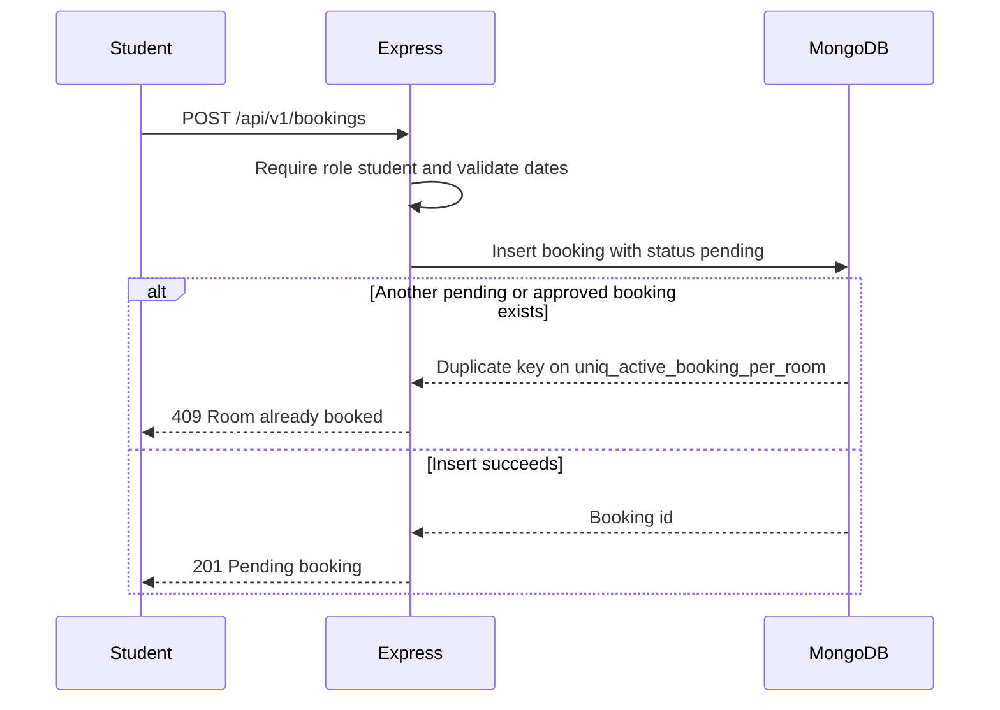
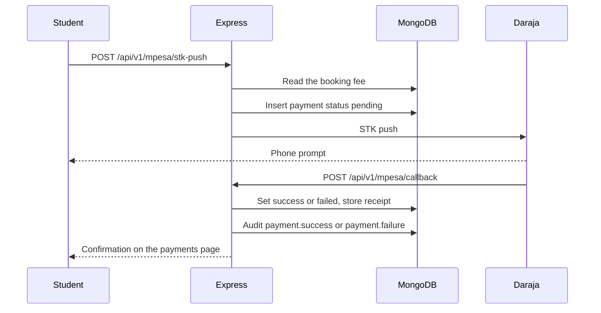

# Architecture

## 1. System context

CampusStay has three runtime parts:

1. A Next.js website that students and staff use in the browser.
2. An Express API that owns accounts, rooms, bookings, payments, and the audit log.
3. MongoDB Atlas, which stores the data.

Safaricom Daraja is an external system. The API will call it for an STK push, and Daraja will call the API callback. That call is specified and not implemented yet.

## 2. Components

| Component                    | Responsibility                                                               |
| ---------------------------- | ---------------------------------------------------------------------------- |
| `frontend/src/app`           | Pages. Public auth screens work. Student and admin screens are placeholders. |
| `frontend/src/middleware.ts` | Blocks guests from student pages and blocks students from `/admin`.          |
| `frontend/src/lib/api.ts`    | `fetch` wrapper that sends cookies and throws typed errors.                  |
| `backend/src/app.ts`         | Helmet, CORS, JSON, cookies, logging, rate limit, routes, errors.            |
| `backend/src/services`       | Business rules. Auth and room listing are implemented.                       |
| `backend/src/models`         | Collections, indexes, and the append-only audit log.                         |

## 3. Request flow

A bad query never reaches MongoDB. The error handler turns a Zod failure into HTTP 400 with `error.details.fieldErrors`.

## 4. Auth flow

The API loads the user from the database on every protected call. A suspended account loses access even if the cookie has not expired. The website checks the cookie so it can redirect before rendering. The API remains the authority.

Public registration always stores `role: student`.

## 5. Booking sequence

This is the target flow. The handlers return 501 until Member 4 implements them. The database rule is already active.

An admin later calls `PATCH /api/v1/admin/bookings/:id/approve` or `.../cancel`. Approval stores `approvedBy` and `approvedAt` and writes `booking.approve` to the audit log.

## 6. M-Pesa payment sequence

Member 4 must verify the callback before trusting it, ignore an amount sent by the browser, and keep `mpesaReceiptNo` unique.

## 7. Technology decisions

| Decision                          | Reason                                                                                                             |
| --------------------------------- | ------------------------------------------------------------------------------------------------------------------ |
| npm workspaces                    | One install, one lint command, and a clean root for five contributors.                                             |
| JWT in an httpOnly cookie         | Browser script cannot read the token. The Next.js proxy keeps the cookie on the website, so middleware can see it. |
| Short expiry, default 15 minutes  | A stolen cookie is useful for a short time. The user signs in again.                                               |
| Zod at the edge of the API        | Handlers receive typed data. MongoDB operators cannot be smuggled in as field names.                               |
| Partial unique index for bookings | Two concurrent requests cannot both win. Application checks alone are not enough.                                  |
| Mongoose `sanitizeFilter`         | A second line of defense if a future query spreads a request object.                                               |
| In-memory MongoDB for tests       | CI does not need an Atlas password.                                                                                |
| Stubs return 501                  | The route, schema, and role are agreed before the feature is written. `TODO(member-N)` shows who owns the rest.    |

## 8. Trust boundaries

- The browser is untrusted. Hidden fields and disabled buttons are not security.
- Next.js middleware improves navigation. It is not a substitute for `authenticate` and `requireRole`.
- The M-Pesa callback is untrusted until Member 4 checks the payload.
- Atlas credentials, the JWT secret, and Daraja keys stay in the environment.
