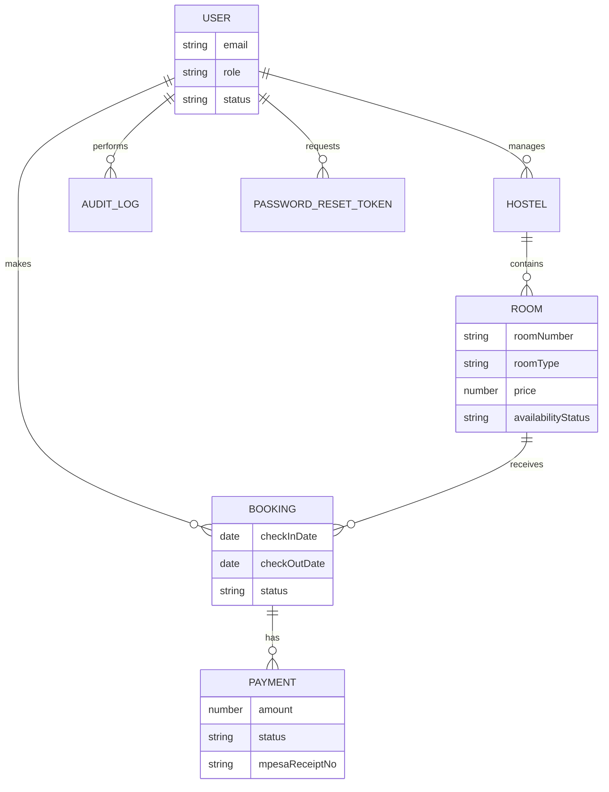

# Database design

CampusStay stores data in MongoDB. Mongoose models live in `backend/src/models`. Every collection has `createdAt` and `updatedAt`.

## 1. Entity relationships

## 2. Collections

### users

| Field        | Type   | Rules                                                   |
| ------------ | ------ | ------------------------------------------------------- |
| fullName     | string | Required, trimmed, 2 to 80 characters                   |
| email        | string | Required, unique, stored in lower case                  |
| phone        | string | Required                                                |
| passwordHash | string | Required, `select: false`, never returned by the API    |
| role         | string | `student`, `admin`, or `super_admin`. Default `student` |
| status       | string | `active` or `suspended`. Default `active`               |
| studentRegNo | string | Optional                                                |

Indexes: unique `email`, plus `role` and `status` for the future admin list.

Interface: `IUser`.

### hostels

| Field        | Type     | Rules                         |
| ------------ | -------- | ----------------------------- |
| name         | string   | Required, unique              |
| location     | string   | Required                      |
| contactPhone | string   | Required                      |
| manager      | ObjectId | Required reference to `users` |

Interface: `IHostel`.

### rooms

| Field              | Type     | Rules                                                 |
| ------------------ | -------- | ----------------------------------------------------- |
| hostel             | ObjectId | Required reference to `hostels`                       |
| roomNumber         | string   | Required. Unique together with hostel                 |
| roomType           | string   | `single`, `double`, `triple`, or `bedsitter`          |
| price              | number   | Required, zero or greater. Kenyan shillings per month |
| capacity           | number   | Required, at least 1                                  |
| availabilityStatus | string   | `available`, `booked`, or `maintenance`               |

Indexes:

- Unique compound `{ hostel: 1, roomNumber: 1 }` named `uniq_hostel_room_number`
- `{ roomType: 1, price: 1, availabilityStatus: 1 }` named `room_search_filters`
- `{ hostel: 1, availabilityStatus: 1 }` named `room_hostel_availability`

Interface: `IRoom`.

Capacity is stored explicitly. The seed uses 1 for single and bedsitter, 2 for double, and 3 for triple. Admins may override it later.

### bookings

| Field        | Type     | Rules                                              |
| ------------ | -------- | -------------------------------------------------- |
| user         | ObjectId | Required reference to `users`                      |
| room         | ObjectId | Required reference to `rooms`                      |
| approvedBy   | ObjectId | Optional reference to `users`                      |
| approvedAt   | date     | Optional                                           |
| bookingDate  | date     | Required                                           |
| checkInDate  | date     | Required                                           |
| checkOutDate | date     | Required                                           |
| status       | string   | `pending`, `approved`, `cancelled`, or `completed` |

Other indexes: `{ user: 1, createdAt: -1 }` and `{ status: 1, createdAt: -1 }`.

Interface: `IBooking`.

### payments

| Field             | Type     | Rules                                          |
| ----------------- | -------- | ---------------------------------------------- |
| booking           | ObjectId | Required reference to `bookings`               |
| amount            | number   | Required, zero or greater                      |
| phoneNumber       | string   | Required                                       |
| mpesaReceiptNo    | string   | Unique and sparse, so pending rows can omit it |
| checkoutRequestId | string   | Optional, indexed                              |
| merchantRequestId | string   | Optional                                       |
| paymentDate       | date     | Optional                                       |
| status            | string   | `pending`, `success`, or `failed`              |

Interface: `IPayment`.

### audit_logs

The model name is `AuditLog`. The collection is `auditlogs` unless a later migration sets another name. The fields are what matter.

| Field      | Type     | Rules                                                            |
| ---------- | -------- | ---------------------------------------------------------------- |
| user       | ObjectId | Optional. Absent for a failed login with an unknown email        |
| action     | string   | Required. Examples: `auth.register`, `auth.login`, `auth.logout` |
| targetType | string   | Required. Example: `user`                                        |
| targetId   | string   | Optional                                                         |
| ip         | string   | Optional                                                         |
| meta       | object   | Optional. Passwords and token hashes are stripped                |

The schema rejects updates and deletes. New facts are new documents. Interface: `IAuditLog`.

### password_reset_tokens

| Field     | Type     | Rules                                                    |
| --------- | -------- | -------------------------------------------------------- |
| user      | ObjectId | Required reference to `users`                            |
| tokenHash | string   | Required. Store a hash, not the raw token                |
| expiresAt | date     | Required. TTL index deletes the document when it expires |

Interface: `IPasswordResetToken`.

## 3. Double-booking strategy

FR3 says the same room cannot be booked twice. Checking `availabilityStatus` in the application is not enough: two students can pass that check at the same time.

The bookings collection has a partial unique index named `uniq_active_booking_per_room`:

- Key: `room`
- Unique: yes
- Partial filter: `status` is `pending` or `approved`

Cancelled and completed bookings stay in the collection for history and do not block a new booking. A second insert with `pending` or `approved` for that room fails with MongoDB duplicate key 11000. The API will turn that into a 409 when Member 4 writes the booking service.

`availabilityStatus` on the room is a display and filter field. The booking index is the rule that protects the transaction. Member 4 should update the room status when a booking is approved, cancelled, or completed, and should still rely on the index.

A test in `backend/tests/booking-index.test.ts` creates two active bookings for one room and expects the second insert to fail.

## 4. Query safety

- Global `sanitizeFilter` is on, so a query object that contains a user-supplied `$` key is sanitized.
- Room price bounds and the "not available" filter use comparison operators written by the service and passed through `mongoose.trusted()`. Zod has already turned the query into numbers and enums. User-supplied objects are still sanitized.
- Handlers never pass `req.body` or `req.query` into `find`.

## 5. Seed data

`npm run seed` is idempotent. Running it again updates the same emails, hostel names, and room numbers.

- 1 super admin, 1 admin, 2 students
- 2 hostels, both managed by the admin
- 10 rooms across the two hostels, including available, booked, and maintenance examples

Demo passwords are listed in the root README. They are not production secrets.
